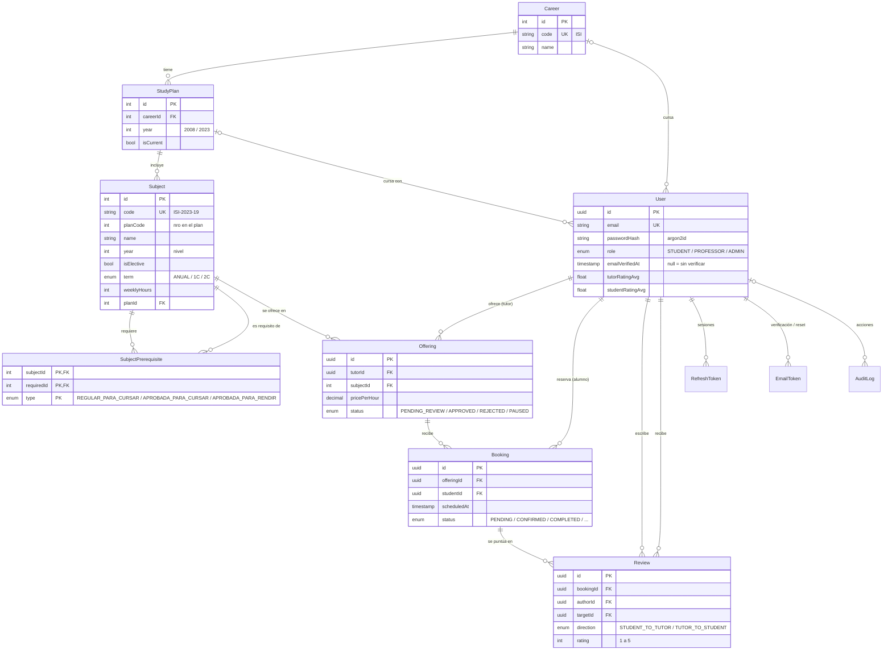

# Base de datos — Tutorías FRT

PostgreSQL 16, gestionada con Prisma (`backend/prisma/schema.prisma` es la fuente de verdad).

## Diagrama entidad-relación



Los planes de estudio cargados por el seed (`backend/prisma/data/planes-isi.js`) son:

| Plan | Materias | Obligatorias | Electivas | Correlativas |
|---|---|---|---|---|
| ISI Plan 2023 (vigente) | 56 | 36 + Seminario Integrador (Analista) | 19 | 119 |
| ISI Plan 2008 (Res. 775/2008, act. 2017) | 59 | 35 | 24 | 419 |

## Conectarse con pgAdmin (o DBeaver)

La base corre dentro de Docker y está publicada **solo en tu PC** en el puerto **5433**
(el 5432 lo usa el PostgreSQL que tengas instalado localmente).

1. Abrí **pgAdmin** → clic derecho en *Servers* → **Register → Server…**
2. Pestaña **General** → Name: `Tutorías FRT (Docker)`
3. Pestaña **Connection**:

   | Campo | Valor |
   |---|---|
   | Host name/address | `localhost` |
   | Port | `5433` |
   | Maintenance database | `tutorias_frt` |
   | Username | `tutorias` (valor de `POSTGRES_USER` en `.env`) |
   | Password | el valor de `POSTGRES_PASSWORD` en `.env` |

4. **Save**. Navegá a *Tutorías FRT (Docker) → Databases → tutorias_frt → Schemas → public → Tables*.
5. Para consultar: clic derecho en `tutorias_frt` → **Query Tool** y pegá las consultas de abajo (F5 ejecuta).

> ⚠️ Prisma crea las tablas con mayúsculas (`User`, `Booking`…). En SQL hay que escribirlas **entre comillas dobles**:
> `SELECT * FROM "User";` — sin comillas PostgreSQL busca `user` y falla.

Desde la terminal también podés entrar sin pgAdmin:

```powershell
docker compose exec db psql -U tutorias -d tutorias_frt
```

## Consultas útiles

### Usuarios registrados y si confirmaron el correo

```sql
SELECT u."email",
       u."firstName" || ' ' || u."lastName"        AS nombre,
       u."role",
       c."code"                                     AS carrera,
       sp."year"                                    AS plan,
       CASE WHEN u."emailVerifiedAt" IS NULL THEN 'NO' ELSE 'SÍ' END AS verificado,
       u."isActive"                                 AS activo,
       u."createdAt"                                AS registrado
FROM "User" u
LEFT JOIN "Career"    c  ON c."id"  = u."careerId"
LEFT JOIN "StudyPlan" sp ON sp."id" = u."studyPlanId"
ORDER BY u."createdAt" DESC;
```

La contraseña **no** se ve: solo el hash Argon2id en `passwordHash` (así debe ser).

### Actividad de login (auditoría)

```sql
SELECT a."createdAt", u."email", a."action", a."ip"
FROM "AuditLog" a
LEFT JOIN "User" u ON u."id" = a."userId"
ORDER BY a."createdAt" DESC
LIMIT 50;
```

### Materias de un plan por nivel

```sql
SELECT s."year" AS nivel, s."planCode" AS nro, s."name", s."term", s."weeklyHours" AS hs, s."isElective" AS electiva
FROM "Subject" s
JOIN "StudyPlan" sp ON sp."id" = s."planId"
WHERE sp."year" = 2023
ORDER BY s."year", s."isElective", s."planCode", s."name";
```

### Correlativas de una materia

```sql
SELECT req."planCode" AS nro, req."name" AS necesita, p."type" AS condicion
FROM "SubjectPrerequisite" p
JOIN "Subject" s   ON s."id"   = p."subjectId"
JOIN "Subject" req ON req."id" = p."requiredId"
WHERE s."code" = 'ISI-2023-19'          -- Bases de Datos, Plan 2023
ORDER BY p."type", req."planCode";
```

### ¿Para qué materias es requisito "Algoritmos y Estructuras de Datos" (Plan 2023)?

```sql
SELECT s."planCode" AS nro, s."name" AS habilita, p."type"
FROM "SubjectPrerequisite" p
JOIN "Subject" s ON s."id" = p."subjectId"
WHERE p."requiredId" = (SELECT "id" FROM "Subject" WHERE "code" = 'ISI-2023-06')
ORDER BY s."planCode";
```

### Ofertas publicadas, reservas y puntuaciones

```sql
-- Ofertas por estado
SELECT o."status", count(*) FROM "Offering" o GROUP BY o."status";

-- Ranking de tutores
SELECT u."firstName" || ' ' || u."lastName" AS tutor, u."tutorRatingAvg", u."tutorRatingCount"
FROM "User" u
WHERE u."tutorRatingCount" > 0
ORDER BY u."tutorRatingAvg" DESC, u."tutorRatingCount" DESC;

-- Materias con más clases dictadas (demanda)
SELECT s."name", sp."year" AS plan, count(*) AS clases
FROM "Booking" b
JOIN "Offering"  o  ON o."id"  = b."offeringId"
JOIN "Subject"   s  ON s."id"  = o."subjectId"
JOIN "StudyPlan" sp ON sp."id" = s."planId"
WHERE b."status" = 'COMPLETED'
GROUP BY s."name", sp."year"
ORDER BY clases DESC;
```
